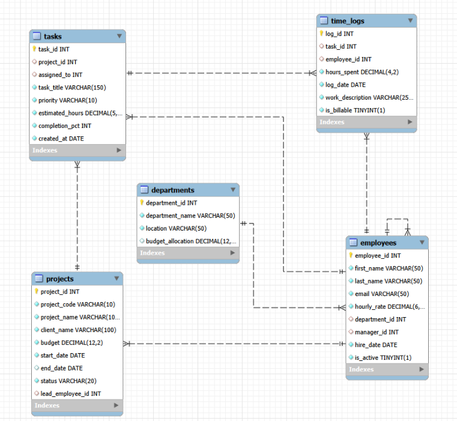

# Midterm Project: Project Management Database Architecture and Analytics

This project encompasses the comprehensive design, implementation, population, and analytical querying of a centralized project management relational database (`pm_db`), completed as the Midterm Project for the **CIS / SQL Programming** curriculum at **Sinclair Community College**.

The system unifies project portfolio management, resource allocation, task tracking, and labor cost analysis, transitioning organizational workflows from fragmented spreadsheets to a robust relational environment[cite: 1].

## Database Overview

- **RDBMS / Tool:** MySQL 8.0 / MySQL Workbench
- **Sample Schema:** `pm_db`
- **Core Tables:** `departments`, `employees`, `projects`, `tasks`, `time_logs`

---

The database entity-relationship diagram is located at `docs/pm_db_erd.png`.



---

## Repository Structure

```text
Midterm_Project/
├── docs/
│   ├── Midterm_Project_Report.docx            # Comprehensive submission report with description, DBDL, and result screenshots
│   └── pm_db_erd.png                          # Relational schema ERD diagram
├── scripts/
│   │   ├── 01_create_pm_db.sql                # Database creation, table DDL, and ALTER TABLE constraints
│   │   ├── 02_insert_pm_db.sql                # Data insertion, archival table workflow, and DML updates
│   │   └── 03_queries_pm_db.sql               # Summary aggregates, filtering, functions, joins, and set operations
└── README.md
```
---
## Technical Scope & Key Features
- **Data Definition Language (DDL):** Creation of 5 normalized relational tables with auto-increment primary keys, unique constraints, NOT NULL rules, default initializations (`CURRENT_DATE`, status flags), and ANSI CHECK constraints (e.g., salary thresholds, completion percentage bounds 0–100, valid date ranges).   
- **Referential Integrity:** Foreign key configurations utilizing cascading rules (`ON DELETE CASCADE` and `ON DELETE SET NULL`).   
- **Data Manipulation & TCL:** Robust DML operations (`INSERT`, `UPDATE`, `DELETE`) for managing records, table backup and archival workflows (`CREATE TABLE ... SELECT` followed by `DROP TABLE`), and transaction control.   
- **Advanced Querying & Aggregations:** Summary reports utilizing `SUM`, `AVG`, `COUNT`, `MIN`, `MAX`, `GROUP BY`, and `HAVING` filters.   
- **Filtering, Functions & Conditional Logic:** Range filtering (`BETWEEN`), multi-value matching (`IN`), pattern matching (`LIKE`), string concatenation (`CONCAT`), date extraction (`MONTH`), text slicing (`SUBSTR`), string length (`LENGTH`), numeric rounding (`ROUND`), conditional categorization (`CASE`), and `IFNULL` transformations.   
- **Multi-Table Joins & Set Operations:** Complex inner/outer joins across 3+ tables and `UNION` set operations.

---

## Tasks Summary

- **Task 1: System Description & Stakeholders**  
  Outlines the project management database objectives, supported tasks, operational processes, target user groups, and system limitations.

- **Task 2: Schema & ERD Architecture**  
  Provides the database definition language (DBDL) and relational Entity-Relationship Diagram (ERD) defining tables and foreign key relationships.

- **Task 3–7: Schema Creation & Constraints (DDL)**  
  Establishes the five core tables (`departments`, `employees`, `projects`, `tasks`, `time_logs`) with auto-increment primary keys, foreign keys, `NOT NULL` rules, default values, and strict ANSI `CHECK` constraints.

- **Task 8: Archival Table & Drop Workflow**  
  Demonstrates creating a backup table (`active_employee_archive`) from another table's structure and data, followed by executing a `DROP TABLE` statement.

- **Task 9: Data Population (DML)**  
  Populates major tables with comprehensive test records utilizing diverse data types (`VARCHAR`, `INT`, `DATE`, `DECIMAL`).

- **Task 10: Data Modifications (UPDATE)**  
  Executes targeted update operations, including salary adjustments via subqueries, task status/priority updates, and project completion timestamping.

- **Task 11: Summary Aggregates & Grouping**  
  Implements summary queries utilizing aggregate functions (`SUM`, `AVG`, `COUNT`, `MIN`, `MAX`), `GROUP BY` clauses, and `HAVING` filtering.

- **Task 12: Filtering, Functions & Expressions**  
  Applies row restrictions using `BETWEEN`, `IN`, and `LIKE` operators, column aliases, basic arithmetic, string concatenation (`CONCAT`), `DISTINCT`, sorting (`ORDER BY`), `NULL` value handling, date extraction (`MONTH`), text slicing (`SUBSTR`), string length (`LENGTH`), and numeric rounding (`ROUND`).

- **Task 13: Conditional Logic & Transformations**  
  Utilizes `CASE` statements for portfolio budget categorization and `IFNULL` functions for unassigned date transformations.

- **Task 14: Multi-Table Joins & Set Operations**  
  Performs complex relational queries including 3-table joins with filtering, `LEFT OUTER JOIN`, `INNER JOIN`, and `UNION` set operations.

- **Task 15: Submission & Documentation**  
  Assembles the comprehensive project report, schema documentation, result screenshots, and fully commented SQL execution scripts.

---

## How to Run

### Using MySQL Workbench (GUI)
1. Open **MySQL Workbench** and establish a connection to your local MySQL server.
2. Open and execute `scripts/01_create_pm_db.sql` sequentially to create the `pm_db` database, define tables, establish columns, defaults, and apply foreign key constraints via `ALTER TABLE`.
3. Open and execute `scripts/02_insert_pm_db.sql` to populate initial test records across major tables, execute the backup table archival workflow, and run the required `UPDATE` statements.
4. Open and execute `scripts/03_queries_pm_db.sql` to run the analytical queries, aggregate functions, `GROUP BY`/`HAVING` filters, scalar transformations, conditional logic, and multi-table joins.
5. Verify your live results against the compiled project report and execution screenshots available in the `docs/` folder.
